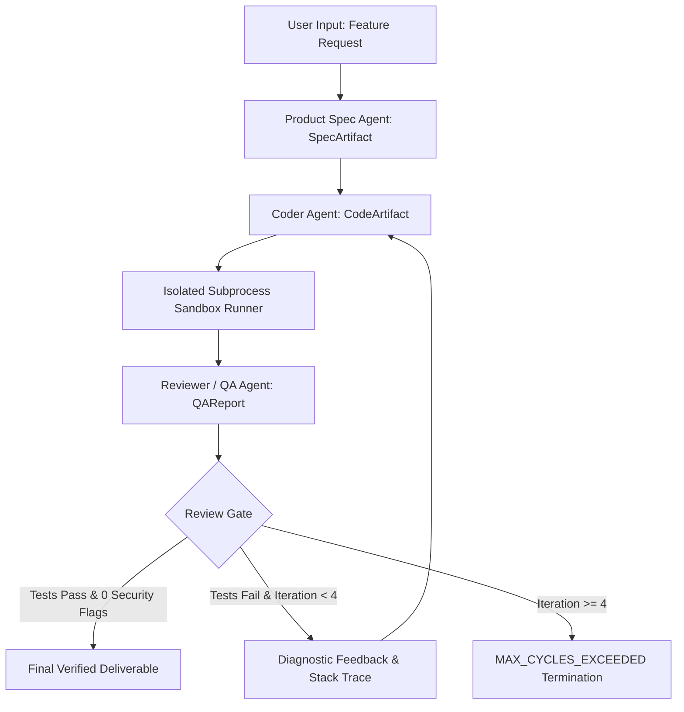

# Autonomous 3-Agent Software Development Squad & Iterative QA Convergence

A deterministic multi-agent software engineering system built with **Python 3.11+**, **LangGraph**, **Pydantic**, **Google Gemini**, and **Streamlit**. Instead of relying on a single LLM that suffers from confirmation bias and hallucinated test passes, an orchestrator coordinates three specialized agents—a **Product Spec Agent**, **Coder Agent**, and **Sandboxed Reviewer/QA Agent**—until `pytest` passes 100% or hits `max_iterations = 4`.

---

## 1. System Architecture & Collaboration Diagram



---

## 2. Installation & Setup Instructions (`uv` + Python 3.11+)

1. **Clone the repository and install dependencies:**
   ```bash
   git clone [https://github.com/eng-bahaeldin/multi-agent-dev-squad.git](https://github.com/eng-bahaeldin/multi-agent-dev-squad.git)
   cd multi-agent-dev-squad
   uv python pin 3.11
   uv sync
   ```
2. **Configure environment variables:**
   ```bash
   cp .env.example .env
   # Add your Gemini API key inside .env:
   # GOOGLE_API_KEY=your_gemini_api_key_here
   # GEMINI_MODEL=gemini-3.8-flash
   ```

---

## 3. Agent & Schema Specifications (`src/schemas.py` & `src/agents/`)

To prevent context window explosion and cumulative token bloat across refinement cycles, agents never forward raw conversational message histories. `SquadState` enforces **least-privilege context partitioning** through three strongly typed Pydantic contracts:

| Schema / Agent | Module | Role & Least-Privilege Payload Contract |
| :--- | :--- | :--- |
| **`SpecArtifact`**<br>*(Product Spec Agent)* | `src/agents/spec_agent.py` | Ingests the raw user feature request and outputs `feature_name`, `requirements`, `test_cases`, and target Python `interfaces`. |
| **`CodeArtifact`**<br>*(Coder Agent)* | `src/agents/coder_agent.py` | Receives `SpecArtifact` (and on cycle > 1, only its immediately preceding `CodeArtifact` plus the latest trimmed `QAReport` error trace) to generate `implementation_code` (`solution.py`), `test_code` (`test_solution.py`), and `iteration`. |
| **`QAReport`**<br>*(Reviewer/QA Agent)* | `src/agents/reviewer_agent.py` | Evaluates `CodeArtifact` in the sandbox and outputs `tests_passed`, `total_tests`, `failed_tests`, `execution_output`, `review_feedback`, and `status` (`PASSED`, `NEEDS_REVISION`, or `MAX_CYCLES_EXCEEDED`). |

---

## 4. Sandbox Security Boundaries (`src/sandbox.py`)

Generated code and unit tests are untrusted payloads and execute inside a hardened subprocess runner:
- **Non-Shell Execution (`shell=False`):** Invokes `[sys.executable, "-m", "pytest", "test_solution.py", "-v", "--tb=short"]` as an explicit argument list, preventing shell command injection.
- **Ephemeral Filesystem Isolation:** Writes `solution.py` and `test_solution.py` inside a `tempfile.TemporaryDirectory()` deleted immediately after the run.
- **Strict Execution Timeout (`timeout=10`):** Terminates infinite loops (`while True`) or deadlocks within 10 seconds via `subprocess.TimeoutExpired`.
- **Environment Secret Scrubbing:** Strips all environment variables containing `KEY`, `SECRET`, or `TOKEN` before spawning the child process so untrusted code cannot read `GOOGLE_API_KEY`.
- **Static Security Audit (`src/agents/reviewer_agent.py`):** Rejects generated code containing `os.system(`, `subprocess.`, `eval(`, `exec(`, `__import__(`, or `shell=True`.

---

## 5. Execution Commands

- **Launch Interactive Streamlit Web Interface:**
  ```bash
  uv run streamlit run src/app.py
  ```
- **Run Automated QA Test Suite (7 Unit & Integration Tests):**
  ```bash
  uv run pytest -v
  ```
- **Run Containerized Stack via Docker Compose:**
  ```bash
  docker compose up --build
  ```

---

## 6. AI Audit Log Summary (`ai_prompt_log.md`)

During code review of the initial AI-generated squad draft, four defects were identified and remediated (see `ai_prompt_log.md` for full before-and-after diffs):
1. **Arbitrary Code Execution & Secret Exposure:** Replaced `shell=True` and inherited host environment variables in `src/sandbox.py` with `shell=False`, `TemporaryDirectory()`, `timeout=10`, and environment secret filtering.
2. **Reviewer Sycophancy Trap:** Removed LLM guessing of test outcomes; `tests_passed` is deterministically bound to physical `pytest` exit code `0` and static security checks.
3. **Context Window Bloat:** Replaced cumulative raw history lists with typed Pydantic schemas (`SpecArtifact`, `CodeArtifact`, `QAReport`) passing only the latest error trace.
4. **Unbounded Refinement Loops:** Enforced an unconditional `max_iterations = 4` circuit breaker in `src/orchestrator.py` exiting cleanly with `MAX_CYCLES_EXCEEDED`.
