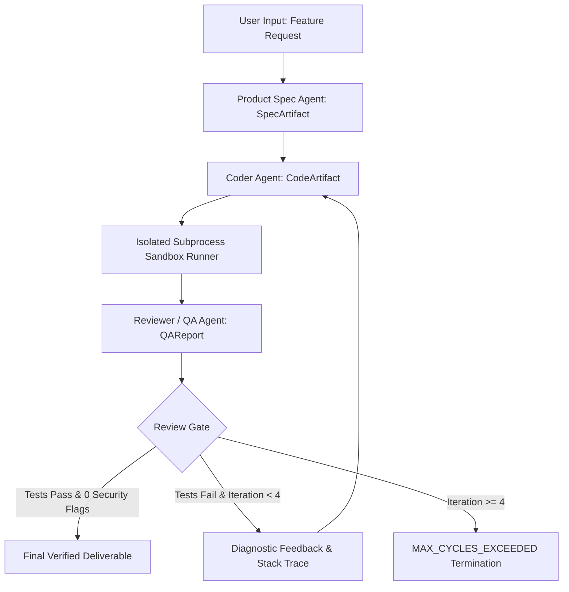

# Autonomous 3-Agent Software Development Squad & Iterative QA Convergence

A deterministic multi-agent software engineering system built with **Python 3.11+**, **LangGraph**, **Pydantic**, **Google Gemini**, and **Streamlit**. Three specialized agents (**Product Spec**, **Coder**, and **Sandboxed Reviewer/QA**) collaborate until `pytest` passes 100% or hits `max_iterations = 4`.

## 1. System Architecture & Collaboration Diagram

## 2. Installation & Setup Instructions (`uv` + Python 3.11+)

1. Clone and install dependencies: `git clone https://github.com/eng-bahaeldin/multi-agent-dev-squad.git && cd multi-agent-dev-squad && uv python pin 3.11 && uv sync`
2. Copy `.env.example` to `.env` (`cp .env.example .env`) and set `GOOGLE_API_KEY` and `GEMINI_MODEL=gemini-3.8-flash`.

## 3. Agent & Schema Specifications (`src/schemas.py` & `src/agents/`)

Agents enforce **least-privilege context partitioning** by exchanging strongly typed Pydantic contracts instead of raw cumulative chat logs:

| Schema / Agent | Module | Role & Payload Contract |
| :--- | :--- | :--- |
| **`SpecArtifact`** (Product Spec Agent) | `src/agents/spec_agent.py` | Decomposes the user request into `feature_name`, `requirements`, `test_cases`, and Python `interfaces`. |
| **`CodeArtifact`** (Coder Agent) | `src/agents/coder_agent.py` | Consumes `SpecArtifact` (and on cycle greater than 1, only the prior `CodeArtifact` + trimmed `QAReport` diff) to output `implementation_code` (`solution.py`), `test_code` (`test_solution.py`), and `iteration`. |
| **`QAReport`** (Reviewer/QA Agent) | `src/agents/reviewer_agent.py` | Evaluates `CodeArtifact` in the sandbox and returns `tests_passed`, `total_tests`, `failed_tests`, `execution_output`, `review_feedback`, and `status` (`PASSED`, `NEEDS_REVISION`, `MAX_CYCLES_EXCEEDED`). |

## 4. Sandbox Security Boundaries (`src/sandbox.py`)

- **Non-Shell Execution (`shell=False`):** Runs `[sys.executable, "-m", "pytest", "test_solution.py", "-v", "--tb=short"]` as a list to prevent shell injection.
- **Ephemeral Directory Isolation:** Executes untrusted code inside `tempfile.TemporaryDirectory()`, deleted immediately after each run.
- **Strict Timeout (`timeout=10`):** Terminates infinite loops (`while True`) within 10 seconds via `subprocess.TimeoutExpired`.
- **Environment Secret Scrubbing:** Strips all environment keys containing `KEY`, `SECRET`, or `TOKEN` before spawning the child process.
- **Static Security Audit:** Rejects `os.system(`, `subprocess.`, `eval(`, `exec(`, `__import__(`, and `shell=True`.

## 5. Execution Commands

- **Web UI:** `uv run streamlit run src/app.py`
- **Automated QA Suite:** `uv run pytest -v`
- **Streamlit Community Cloud:** Deploy `src/app.py` from `main` on `share.streamlit.io` with `GOOGLE_API_KEY` and `GEMINI_MODEL` set in App Secrets.

## 6. AI Audit Log Summary (`ai_prompt_log.md`)

1. **ACE & Secret Exposure:** Replaced `shell=True` and inherited env vars with `shell=False`, `TemporaryDirectory()`, `timeout=10`, and secret scrubbing.
2. **Reviewer Sycophancy Trap:** Bound `tests_passed` deterministically to `pytest` `exit_code == 0` instead of LLM guessing.
3. **Context Window Bloat:** Replaced growing raw history arrays with typed Pydantic schemas passing only the latest error trace.
4. **Unbounded Loops:** Enforced an unconditional `max_iterations = 4` circuit breaker in `src/orchestrator.py`.
